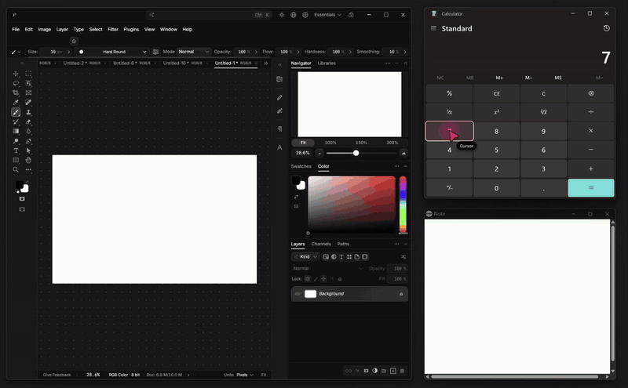

# deskcrew

**Windows, with early macOS and Linux (X11 / Xvfb) versions; Wayland is not supported.** Every coding agent gets its own cursor on your desktop, works in the background, and costs very few tokens.


Agents act through Windows accessibility, window messages and a synthetic pen, so your cursor stays yours. Each agent appears as a drawn cursor in its own colour with its name beside it. The cursor glides to a control along a curve, leaning into the move, and the control lights up with an outline in that colour when it is pressed. While an agent types, its cursor becomes a caret that follows the text. Agents work side by side while you keep working, even while you use another app full screen.


**Above, and [as a video](demo/deskcrew-demo.mp4):** three agents draw a house, fill in and place an order, and type a note at the same time, in throwaway windows. `demo/record.py` records it again.

It is a single command, so any agent that can run a shell command on this computer can use it: Claude Code, Cursor, Codex, Gemini CLI, Copilot, Windsurf, OpenCode, Aider and the rest. Apps that call tools instead of a shell, such as Claude Desktop, can use it as an [MCP server](#as-an-mcp-server).

## Quick start

```bash
cargo install deskcrew
deskcrew setup
```

Then ask your agent to do something in a desktop app, such as "add 12 and 30 in Calculator". `setup` tells every agent app it finds to use deskcrew on its own.

## Works with

| Agent | How it uses deskcrew |
| --- | --- |
| Claude Code | `setup` adds a skill and a rule, or as an MCP server: `claude mcp add deskcrew -- deskcrew mcp` |
| Codex | `setup` adds a skill and a rule, or as an MCP server: `codex mcp add deskcrew -- deskcrew mcp` |
| Cursor | `setup` adds a skill and prints a rule for Cursor's settings, or as an MCP server in `~/.cursor/mcp.json` |
| Claude Desktop | as an MCP server ([config](#as-an-mcp-server)) |
| Gemini CLI, Copilot, Windsurf, OpenCode, Amp, Qwen Code, Factory, Kiro, Continue, Cline | `setup` adds a rule, and a skill where the app takes one ([details](#try-it)) |
| Anything else that runs shell commands | the `deskcrew` command; `deskcrew help` lists everything |

## Try it

```bash
cargo build --release
```

```bash
target/release/deskcrew demo --seconds 12
```

The demo moves three pretend agents around the screen and clicks nothing.

To make it available to your agents:

```bash
target/release/deskcrew setup
```

That puts `deskcrew` on PATH and sets up every agent app and CLI it finds, so they use deskcrew on their own whenever a task needs the desktop, instead of built-in computer use or other desktop tools. Run it again after installing a new agent; it updates what it wrote instead of adding copies, and leaves the rest of each file alone. You can also ask your agent to install deskcrew for you.

| Agent (app and CLI) | What setup writes |
| --- | --- |
| Claude Code | skill in `~/.claude/skills`, rule in `~/.claude/CLAUDE.md` |
| Codex | skill in `~/.codex/skills`, rule in `~/.codex/AGENTS.md` |
| Gemini CLI and Antigravity | skill in `~/.gemini/skills`, rule in `~/.gemini/GEMINI.md` |
| GitHub Copilot CLI | skill in `~/.copilot/skills`, rule in `~/.copilot/copilot-instructions.md` |
| GitHub Copilot in VS Code | rule in VS Code's user `prompts/deskcrew.instructions.md` |
| Windsurf | skill, and rule in `~/.codeium/windsurf/memories/global_rules.md` |
| OpenCode | skill, and rule in `~/.config/opencode/AGENTS.md` |
| Amp, Qwen Code, Factory Droid | rule in `~/.config/amp/AGENTS.md`, `~/.qwen/QWEN.md`, `~/.factory/AGENTS.md` |
| Kiro, Continue, Cline | rule file in `~/.kiro/steering`, `~/.continue/rules`, `~/Documents/Cline/Rules` |
| Cursor | skill in `~/.cursor/skills`. Its User Rules live in your Cursor account, so setup prints the rule to add under Customize > Rules > New |
| Grok, and agents sharing `~/.agents` | skill |

The rule sits between `<!-- deskcrew: start -->` and `<!-- deskcrew: end -->` lines. For any other agent, add the rule setup prints to its own rules. Agents running in the cloud, or in a sandbox without access to your desktop, cannot reach it.

### As an MCP server

`deskcrew mcp` serves the same commands as four MCP tools over stdio: `see`, `do`, `shot` (which sends the picture itself) and `deskcrew` for any other command. Use it for apps that cannot run a shell command, or if you prefer tools to a rule. Each client below needs `deskcrew` on PATH; `setup` puts it there.

| Client | How to add it |
| --- | --- |
| Claude Code | `claude mcp add deskcrew -- deskcrew mcp` |
| Codex | `codex mcp add deskcrew -- deskcrew mcp` |
| Claude Desktop | in `claude_desktop_config.json` (Settings > Developer > Edit Config): `"mcpServers": { "deskcrew": { "command": "deskcrew", "args": ["mcp"] } }` |
| Cursor | the same `mcpServers` entry in `~/.cursor/mcp.json` |
| Gemini CLI | the same `mcpServers` entry in `~/.gemini/settings.json` |
| VS Code (Copilot) | in `.vscode/mcp.json` or your user `mcp.json`: `"servers": { "deskcrew": { "type": "stdio", "command": "deskcrew", "args": ["mcp"] } }` |

Codex's own config takes it as:

```toml
[mcp_servers.deskcrew]
command = "deskcrew"
args = ["mcp"]
```

Each client shows up as its own cursor, named from what the client calls itself (Claude, Codex, Cursor...). Set `DESKCREW_AGENT` in the server's environment to choose the name.

## macOS

**The macOS version is early.** It was written on a Windows PC and has only run on GitHub's Mac runners so far. On every push, CI builds it for Apple Silicon and Intel, runs its unit tests, and drives TextEdit there: `windows`, `apps`, `screens`, `see`, typing with `do`, `get` and the clipboard all work. Pictures (`shot`) need Screen Recording, which the runners do not give, and no one has tried it on their own Mac yet. If you try it on a Mac, please [open an issue](https://github.com/acus9345/deskcrew/issues/new/choose) with how it went.

It has the same commands and replies, built on Mac parts:

- Controls are read through the accessibility API and pressed with their own actions, such as `AXPress`, so a click works behind other windows without taking focus.
- Clicks on points, drags, scrolls and keys are posted to the one app being worked on, so your pointer does not move and your front app keeps its keys. Chrome, Electron apps and others that only take keys while in front get a named field's text put in letter by letter through accessibility instead, so they stay in the back.
- Pictures come from the window itself, and text in parts with no controls is read with Apple's Vision.
- Cursors are see-through windows ordered just above the agent's window, so your other windows can cover them.
- Ctrl+Option+Esc stops every agent.

macOS asks once for Accessibility permission, and again for Screen Recording the first time a picture is taken. Both are granted to the app running your agent, such as Terminal, iTerm or Cursor. `setup` installs to `~/.cargo/bin` or `~/.local/bin`, adding the latter to `~/.zprofile` if it is not on PATH.

Most commands and flags now match Windows: `check`, `uncheck`, `toggle`, `expand`, `collapse`, `clear`, `is`, `select`, `hover`, `show`, `draw`, `drag`, `down` and `up` for modifier keys, `place`, `focus`, `close`, `screens`, `apps`, `clip`, `shot --screen`, `do --dry` and `--risk`, `wait --gone`, `type --paste`, `--fast`, `--with`, and middle, back, forward and triple clicks. `--real` brings the app forward for a moment and sends keys through the system, then gives the front back.

Not on the Mac yet: `table`, `pick-file`, sideways `scroll`, `click --hold`, `--mouse` and borrowing the cursor, holding a mouse button, `notifications` and the demo. On a Mac, `down` holds modifier keys only, and they apply to that agent's later clicks and keys in that app.

```text
$ deskcrew see Calculator
w2 "Calculator" 37 controls, 1 off screen
e12 button "One"
...
$ deskcrew click e12
ok invoke
~ e4 "Display is 1"
```

Run `deskcrew help` for every command. A background service starts itself on first use and exits after 30 idle minutes.

`deskcrew log` shows the last 30 commands agents gave it (`deskcrew log 200` for more): when, which agent, the command, whether it worked and the first line of the reply. Typed text, clipboard text and file contents show only their length, since they may be passwords. The log is `deskcrew/log.txt` in your local app data (`~/Library/Caches` on a Mac, `~/.cache` on Linux) and keeps about the last 2 MB.

## Linux (X11 / Xvfb)

**Linux (X11 / Xvfb); Wayland not supported.** Wayland does not let one app read or drive another's windows, so on a Wayland session deskcrew says so and stops. Log in to an X11 (Xorg) session, or run the apps on a virtual display such as Xvfb, which is how agents on cloud machines and in CI usually work.

The Linux version is the newest and least tried. CI runs it on Ubuntu under Xvfb on every push, against a GTK window and against a toolkit-free test window (`examples/linux_form.rs`) on a bare accessibility bus.

- Controls are read and pressed through AT-SPI, the accessibility bus GTK, Qt, Firefox, Chromium and LibreOffice speak, so `see`, `set`, `check`, `select` and pressing buttons work in the background, behind other windows, without the pointer. GTK apps take part once the bus is running. Qt apps need `QT_LINUX_ACCESSIBILITY_ALWAYS_ON=1`, and Chrome `--force-renderer-accessibility`.
- Keys and typing go through XTest to the agent's window, which gets the keyboard for a moment without being raised: X keeps the keyboard focus apart from which window is on top, so your window stays in front. This also reaches apps that ignore keys while behind others, such as Chrome. Anything you type during those moments goes to the agent's window.
- Scrolling moves a scroll bar through AT-SPI where the app has one, so the window stays where it is.
- A click on an x,y point where a button, check box, tab, link, menu entry or list item is drawn presses it through AT-SPI, in the background (CI builds this; it was not run against a live app). Other clicks on x,y points, drags, drawing and scrolling where there is no scroll bar use the X pointer, so deskcrew brings the window forward for a moment, uses it, then puts the pointer and the front window back. GTK, Qt and Chrome read the pointer through XInput 2 and ignore made-up X events, so there is no background way for these. On a virtual display no one notices; on a person's own desktop the pointer moves briefly.
- The window list comes from the window manager, or straight from the X server on a bare Xvfb with none.
- The accessibility bus is the one `AT_SPI_BUS_ADDRESS` or the display names, or else the one at-spi2-core starts. Without at-spi2-core's registry, deskcrew finds the apps on the bus itself.
- Each agent has its drawn cursor, as on Windows and the Mac. Its edges are smooth with a compositor, and cut to its outline on a bare Xvfb. The name is drawn in Liberation Sans Bold, or DejaVu Sans Bold, whichever is installed. deskcrew's own shots leave the cursors out.
- There are no `table`, `pick-file` or `notifications` on Linux yet, and no typing caret: the name tag pulses instead. The clipboard needs `xclip` or `xsel`.

To try it on a virtual display:

```bash
sudo apt install xvfb at-spi2-core xclip
Xvfb :99 & export DISPLAY=:99
dbus-run-session -- bash -c 'gedit & sleep 2; deskcrew see gedit'
```

Each X display gets its own background service, so agents on `:99` and `:0` never mix.

## Why it is cheap

- Each control is one short line, and refs stay valid, so a window is read once. Labels that repeat a control's name, spinner arrows and dropdown buttons are left out, and a grid row is one line, with the rows scrolled out of sight added when they fit.
- Every action replies with only what changed, new dialogs and their text included, so there is nothing to read again.
- `do` runs a whole task in one call: names work in place of refs, and it goes on into the dialogs its steps open. A name that fits several controls picks the one that can take the action.
- Pictures are files that are only sent if the agent opens them. An unchanged picture is reported as `unchanged`.
- `see` points out any large part of a window with no controls, such as a canvas or a game, and reads the text in it with Windows' own offline OCR. Clicks can use the x,y it gives, so a picture is only needed for drawings, and then only of that part.
- When an action changes no control, its reply says whether the window's picture changed and where, so the agent doesn't need a picture to check.

Measured on 2026-11-01 against agent-desktop 1.0.2, in characters an agent has to read, on throwaway windows at 150% scaling. Its figures use `snapshot -i --compact`. These are characters, not tokens, and agent-desktop's `--skeleton` mode reads less by leaving detail out.

| Reading a window | Controls | agent-desktop | deskcrew | Time, agent-desktop | Time, deskcrew |
| --- | --- | --- | --- | --- | --- |
| Test form | 42 | 10,138 | 1,047 | 191 ms | 74 ms |
| Character Map | 11 | 3,603 | 260 | 177 ms | 24 ms |
| Calculator | 37 | 9,350 | 689 | 175 ms | 25 ms |
| File Explorer | 121 | 39,595 | 3,375 | 296 ms | 62 ms |

For `1 + 2 =` on Calculator, knowing the result of every press took 48,570 characters with agent-desktop, reading after each press, and 811 with deskcrew. The tool's help is 1,903 characters.

## Compared with agent-desktop

[agent-desktop](https://github.com/vercel-labs/agent-desktop) inspired this project and reaches further. The reading figures above were measured; the rest of its column comes from the agent-desktop 1.0.2 documentation.

| | agent-desktop | deskcrew |
| --- | --- | --- |
| Platforms | macOS, Windows, Linux | Windows; macOS and Linux (X11) newer, tested in CI |
| Used from | command line, or a library called in process | command line, an agent skill, or an MCP server |
| Reading a window | 3,603 to 39,595 characters in the tests above | 260 to 3,375 characters, about 10 times less |
| Drawn cursors | `cursor-overlay`, with `--multi-agent` for one per agent; always on top of other windows | always on, one per agent with no setup, and covered by whatever covers their window |
| Clicks, typing, toggles, menus, scrolling, drag | yes | yes |
| Holding a key | listed, but refuses to run for now | `down` and `up`, released by itself after 30 s |
| Holding a mouse button | listed, but refuses to run for now | `down left x,y --mouse`, with your permission |
| Your cursor | moved by `--headed` mouse commands | moved only if you allow it |
| Clipboard, windows, launching apps | yes | yes |
| Notifications | yes | `notifications`, which opens the panel and takes focus until `notifications close` |
| System surfaces | `open-system-surface` | `launch` with a Windows link such as `ms-settings:` |

Pick agent-desktop if you want it as a library, or need macOS or Linux support that has been used more widely. Pick deskcrew if you want several agents on screen for fewer tokens, especially on Windows.

## Compared with other Windows tools

Measured on 2026-11-04 on the same machine, reading the same four throwaway windows three times with each tool, all in one run. These are characters an agent has to read, not tokens, and only reading was measured, not acting.

| Reading a window | deskcrew 0.1.9 | [agent-desktop](https://github.com/vercel-labs/agent-desktop) 1.1.0 | [agent-cu](https://github.com/kortix-ai/agent-computer-use) 0.1.1 | [mcp-windows](https://github.com/sbroenne/mcp-windows) 1.3.28 | [Windows-MCP](https://github.com/CursorTouch/Windows-MCP) 0.8.8 |
| --- | --- | --- | --- | --- | --- |
| Test form | 488 | 9,641 | 1,776 | 7,089 | 4,216 |
| Character Map | 485 | 3,664 | 823 | 3,760 | 3,007 |
| Calculator | 689 | 9,394 | 2,199 | 8,212 | 4,680 |
| File Explorer | 3,381 | 39,798 | 8,938 | 26,635 | 10,897 |
| Time per read after the first | 22 to 101 ms | 192 to 308 ms | 0.13 to 4.4 s | 30 to 210 ms | about 14.5 s |
| What an agent loads to learn the tool | 2,469 characters of help | 8,934 characters of help | a skill | 58,165 characters of tool schemas | 25,054 characters of tool schemas |

How each tool was called:

- deskcrew: `see -f`.
- agent-desktop: `snapshot --window-id w-<handle> -i --compact`, its interactive, compact mode. Its `--skeleton` mode reads less by leaving detail out, and was not measured.
- agent-cu: `snapshot -i -c`, its recommended compact mode. Its npm package has no Windows program, so it was built from the GitHub source. Its read time swung between about 0.1 s and 4 s from window to window.
- mcp-windows: `ui_snapshot` in full mode. Its incremental mode makes repeated reads cheaper and was not measured.
- Windows-MCP: `Snapshot` without a picture. It always reads the whole desktop, other windows and taskbar included, so its figures change with what else is open and are not for one window alone. It waits while the person is using the computer, and refuses to run while a screensaver is on.

## Agents doing whole tasks

Reading a window is only part of the cost. This measures what an agent spends to finish a task, in the tokens the API reports. Measured on 2026-11-08 with Claude Code 2.1.318 running Sonnet 5.5 headless at its default effort, three runs per tool, on the same machine, on throwaway windows. Each figure is the median of the three. "Right" is checked from the app's own log, not from what the agent said.

- **Order form:** fill in name, email, quantity, country, shipping and gift wrap, submit, confirm the dialog, and report the order number.
- **Stock grid:** find the item with the lowest stock in an 80-row grid, type its name into a box, press Check, and report the result.

| Order form | Right | Time | Model calls | Tokens read | Tokens written | Cost |
| --- | --- | --- | --- | --- | --- | --- |
| deskcrew (this version) | 3 of 3 | 17 s | 5 | 50,187 | 420 | $0.039 |
| agent-desktop 1.1.0 | 0 of 3 | 55 s | 11 | 209,974 | 1,419 | $0.119 |
| agent-cu | 3 of 3 | 348 s | 15 | 305,637 | 2,013 | $0.138 |
| mcp-windows 1.3.28 | 3 of 3 | 73 s | 20 | 760,113 | 3,154 | $0.205 |
| Windows-MCP 0.8.8 | 3 of 3 | 98 s | 10 | 372,519 | 1,394 | $0.210 |

| Stock grid | Right | Time | Model calls | Tokens read | Tokens written | Cost |
| --- | --- | --- | --- | --- | --- | --- |
| deskcrew (this version) | 3 of 3 | 11 s | 4 | 41,373 | 293 | $0.041 |
| agent-desktop 1.1.0 | 3 of 3 | 26 s | 8 | 142,283 | 1,338 | $0.107 |
| agent-cu | 3 of 3 | 26 s | 6 | 129,703 | 676 | $0.111 |
| mcp-windows 1.3.28 | 3 of 3 | 57 s | 19 | 1,035,417 | 4,486 | $0.311 |
| Windows-MCP 0.8.8 | 3 of 3 | 127 s | 15 | 413,186 | 2,490 | $0.165 |

Tokens read count everything sent to the model on every call, most of it from the prompt cache, which is billed at a tenth of the price; cost is what the API charged. Sonnet hardly thought on these tasks with any tool, so the time is mostly calls to the model and the tool's own work.

How each tool was set up: every agent had only Bash and the Skill tool built in, none of your own settings, and the tool the way its README says to install it. deskcrew got what `setup` writes; agent-desktop its bundled skill and the lines its README gives for an agent's instructions; agent-cu its skill from skills.sh, built from source as above; mcp-windows and Windows-MCP as MCP servers.

What happened with the others:

- agent-desktop could not pick the form's WinForms radio button in its background mode: every click or select on it timed out. Each run stopped there and asked to use the real mouse, so no order was placed.
- agent-cu got every order right, but its click on Submit waited about two minutes while the confirm dialog was open, and other reads waited 30 to 60 seconds.
- mcp-windows and Windows-MCP finished every task, using the real mouse and keyboard, with their tool schemas sent on every call.

Compared with deskcrew 0.1.11 under the same agent, this version took the order form from 29 s and 6 model calls to 17 s and 5, and the stock grid from 19 s and 7 calls to 14 s and 4, with 47% fewer tokens read. Those before-and-after runs were on a hidden desktop, where nothing can reach the person's screen. [`bench/`](bench/README.md) has the tasks and the runner.

## Features compared

From each tool's own README, help and tool list, checked on 2026-11-03. A dash means its documentation does not mention it.

| | deskcrew | [agent-desktop](https://github.com/vercel-labs/agent-desktop) | [agent-cu](https://github.com/kortix-ai/agent-computer-use) | [Windows-MCP](https://github.com/CursorTouch/Windows-MCP) | [mcp-windows](https://github.com/sbroenne/mcp-windows) |
| --- | --- | --- | --- | --- | --- |
| Form | command line, skill and standing rules | command line, C library | command line, skill | MCP server | MCP server, VS Code extension |
| Platforms | Windows; macOS written, not yet run | macOS, Windows, Linux | macOS, Windows, Linux | Windows | Windows |
| Sets up your agents for you | 15 agent apps and CLIs | — | skill installer and `setup` | — | — |
| Controls by stable ref | yes | yes, checked again before acting | yes | labels | element ids |
| Replies show only what changed | yes | — | — | — | incremental snapshots |
| Leaves your mouse alone | yes; borrowing it needs your permission | moves it in `--headed` mode | clicks without taking focus | no | uses it for canvases |
| Several agents at once | yes, in parallel | takes turns | — | — | — |
| A drawn cursor per agent, coverable by your windows | yes | one overlay, always on top | — | — | — |
| Works in covered windows | mostly | — | — | no | — |
| Drawing strokes | yes | drag | drag | drag | yes |
| Reads text from pictures | yes, offline OCR | no | — | through a vision model | — |
| Says whether the picture changed | yes | — | — | — | — |
| Screenshots | yes | yes | yes | yes, annotated | — |
| Tables and grids | `table` | — | — | — | yes |
| Open and Save dialogs | `pick-file` | — | — | — | yes |
| Web pages | windows as apps, and `fetch` for page text | agent-browser | Electron apps | page DOM and scraping | Edge and Chrome pages |
| Batches | `do`, `--expect` | — | `batch`, YAML workflows | multi-select and multi-edit | `ui_batch` |
| Wait for text | yes | yes | yes | yes | yes |
| Hold keys and buttons | yes, let go after 30 s | listed, not working yet | — | — | — |
| Move, resize and close windows | yes | yes | move and resize | yes | yes, with monitors |
| Clipboard | yes | yes | — | yes | — |
| Notifications | read, dismiss and send | yes | — | send | — |
| System settings pages | `settings` | system surfaces | — | — | — |
| Shell commands | `run` | — | — | PowerShell | — |
| Files | `file`, deleting to the Recycle Bin | — | — | yes | — |
| Processes | `processes`, `kill` | — | — | yes | — |
| Registry | `reg`, writing only your own settings | — | — | yes | — |
| Stop switch | Ctrl+Alt+Esc stops every agent | refuses stale refs | — | waits while you use the computer | — |

## Beyond windows

These run in the command itself, without the service, so an agent can do the work around an app without switching tools.

| Command | What it does |
| --- | --- |
| `processes [filter]` | Running programs, with their window titles |
| `kill pid\|name [--force]` | Ends a program. It refuses Windows' own processes and the agent's own shell, and needs `--force` for Explorer or for a name that matches several |
| `run "command" [--ms N]` | Runs a PowerShell command (zsh on a Mac) and returns its output and exit code, stopping after 60 s unless `--ms` says otherwise |
| `fetch URL [--raw]` | A web page as plain text, or as it came with `--raw` |
| `file list\|read\|write\|append\|find\|copy\|move\|trash` | Files and folders. `write`, `copy` and `move` refuse to replace a file without `--force`, and `trash` uses the Recycle Bin so nothing is lost |
| `reg get\|list\|set` | The registry. `set` only writes under `HKCU`, the person's own settings |
| `notify "title" "message"` | A Windows notification |
| `settings [page]` | Opens a page of Settings, such as `display` or `bluetooth` |
| `table e5 [--from N]` | A table or grid, such as a file list or data grid, as tab-separated rows with its headers |
| `pick-file "path"` | Fills an Open or Save dialog and presses its button, in any Windows language |

## How actions reach an app

Each reply names the route it took.

| Route | Used for | Your cursor | Your focus |
| --- | --- | --- | --- |
| `invoke`, `toggle`, `select`, `expand`, `value`, `range`, `scroll` | the app's own accessibility actions | untouched | some apps take it for a moment, and it is handed straight back |
| `command`, `message` | classic Windows controls and menus, plus clicks, typing, `drag` and `draw` in browsers and Electron apps, by window message | untouched | untouched in classic apps, and a Chromium window can take it for a moment |
| `pen` | `drag`, `draw` and `--real` in apps that draw themselves and ignore messages, such as Paint | untouched | borrowed for the action |
| `keyboard` | `key`, `type` and `set` with `--real` | untouched | borrowed for the action |
| `mouse` | only `--mouse`, and only if you allow it | moved, then put back | borrowed for the action |

**Nothing moves your cursor unless you say so.** Borrowing it is off by default. Run `deskcrew cursor ask` to let agents ask, and an agent that needs it gets a prompt on screen: **Just this once**, **This session**, **Always** or **No**. No answer in a minute counts as no, and the prompt never takes focus, so your typing cannot answer it.

| `deskcrew cursor` | Effect |
| --- | --- |
| `off` | the default: no agent can borrow it, and any earlier permission is cleared |
| `ask` | agents may ask each time |
| `session` | every agent may borrow it until deskcrew stops |
| `always` | every agent may borrow it when needed, until you run `off` |

Anything except `off` opens a prompt you have to accept. This stops an agent from turning it on by accident or by habit, but it is not a security boundary: anything running as you can edit `%LOCALAPPDATA%\deskcrew\cursor.txt` or click the prompt.

Some classic controls answer an accessibility request by quietly clicking with the real mouse, so a shield blocks every synthetic mouse event while those requests run. A control that needs that is refused with a message instead. In tests, Paint drawing and Edge presses caused no synthetic mouse events at all.

**Cursors and press effects can be covered.** They sit directly above the window they work on, and above its menus and popups, not on top of everything. Put another window over that app and it covers the cursor and the effect too. `deskcrew demo` has no window to follow, so it stays on top.

**Focus is a last resort.** Every action tries a background route first, and only `--real`, `down`, `notifications` and `launch --front` take focus on purpose. `type --paste` and `click --with ctrl` run in the background, and so do keyboard shortcuts such as Ctrl+S and Ctrl+A in classic apps, Windows Terminal and Store apps.

Anything that borrows focus waits for a pause in your own typing, is one agent at a time, and gives focus back afterwards. It is refused if a point is not on the target window, so it cannot land on something else you have open.

Agents in different windows click, type and draw at the same time. In a test on 2026-11-01, three agents each typed in two fields, pressed a button and drew in their own visible Edge window, all at once, using separate browser profiles. Over three rounds that took 3.5 to 3.9 s against about 3 s for one agent alone. Everything landed in the right window, there were no synthetic mouse events, and focus left the person's window for about 100 ms in total each round. `type` reads a field back and sets it directly if Chromium dropped the characters.

Agents in one window take turns, because an app has one mouse state and one text cursor. In browsers and Electron apps, `draw` cuts strokes into short overlapping pieces and rotates between agents, so several can draw on one canvas at once. Three trees took about 9 s together this way. Each piece is a separate brush stroke, so undo steps back in small pieces. The pen and `--real` also take turns across all windows, because they need the window in front.

**Ctrl+Alt+Esc** stops every agent. Reading still works, and work resumes with `deskcrew resume`. Shortcuts such as Alt+F4 and Win+R are refused without `--force`.

## Tests

```bash
cargo test
```

```bash
cargo test --release --test desktop -- --ignored --nocapture
```

The second one drives throwaway windows it opens itself, including the real keyboard and mouse for a few seconds, so leave the machine alone while it runs. It has 65 checks, and it counts synthetic mouse events to prove when the cursor was left alone.

[`bench/`](bench/README.md) gives a coding agent the same desktop task with each tool and measures the time, model calls, tokens and cost, and whether the result was right.

## Coming from desk-pilot

[desk-pilot](https://github.com/acus9345/desk-pilot) is the earlier tool by the same author, which drove the real mouse and keyboard. Everything it did is in deskcrew, which works in the background instead. With `deskcrew mcp` its three tools map like this:

| desk-pilot | deskcrew |
| --- | --- |
| `screen_view` (screen, window or region, rulers) | `shot` tool, or `shot --screen`, `shot --region x,y,w,h`, `--rulers`; `--changed` for only what changed |
| `desktop_control` `controls` | `see` |
| `desktop_control` click kinds, modifiers, long press | `click` with `--right`, `--double`, `--triple`, `--middle`, `--back`, `--forward`, `--with ctrl+shift`, `--hold ms` |
| `move`, `drag`, `draw`, `down`/`up`, `scroll` | `hover`, `drag`, `draw`, `down`/`up`, `scroll` (up, down, left or right) |
| `type`, `key`, `focus`, `waitFor`, `launch`, `clipboard` | `type`, `key`, `focus`, `wait`, `launch`, `clip` |
| `window` (move, resize, minimize, maximize, restore), `windows`, `screens` | `place`, `windows`, `screens` |
| `desktop_sequence` with `risk` and `dryRun` | `do` with `--risk` and `--dry` |

desk-pilot always moved your real pointer; deskcrew only does with `--real` or `--mouse`, as a last resort.

## Limits

- The Windows version is the tested one. The macOS version has never been run (see [macOS](#macos)), and Linux is not written.
- On a Mac, pictures use `CGWindowListCreateImage`, which Apple has deprecated. A future macOS may stop it working, and then pictures would need ScreenCaptureKit.
- On a Mac, typed text goes out as key events carrying the characters. An app that reads key codes instead may get the wrong letters.
- `notifications`, `down` and `--real` take focus, so they can interrupt what you are doing. A key held with `down` reaches whichever window has focus, and is let go after 30 s, on `quit` and on Ctrl+Alt+Esc. If deskcrew is killed outright it stays down until you press that key.
- `--real` typing stops if focus leaves the window, and reports how much it had typed.
- `click --with ctrl` sends the modifier with the click, and also sets it down in the app's own copy of the keyboard state for that moment, for apps such as WinForms that ask the keyboard instead. `key x --hold ms` holds a key the same way, with repeats as a keyboard sends them, in the background; a held key across commands (`down`) still needs `--real`.
- `expand` needs a control that offers it: a WinForms combo box does not, so use `select` there.
- The newest commands, such as `hover`, `down`, `check`, `is` and `notifications`, were tested by hand on throwaway windows and are not in the 65-check suite yet.
- Keyboard shortcuts go in the background as window messages: for that moment the app's own copy of the keyboard state has Ctrl, Shift or Alt held, and yours does not. They reach classic apps, WinForms, Windows Terminal, Store apps and Edge, to the control an agent last clicked or typed in. WPF apps read keys only while their window has keyboard focus, so for those moments deskcrew gives it focus inside its own app, with Windows' foreground lock held so it cannot come forward; the keys go to whatever the app last had focused. The Windows key needs `--real`. While a `--real` action runs, anything you type goes to that window.
- Windows Terminal and Store apps (Calculator, for one) take typing and keys in the background, but not posted clicks: their buttons are pressed through accessibility instead. The same goes for WPF apps, and for `click x,y` on any app that draws itself: the button, check box, tab or list item drawn at that spot is pressed through accessibility. A spot with only a drawing surface still needs `--real`. Some Store apps, Calculator among them, read Enter and Escape only from the real keyboard, and Windows lets no other app share a Store app's input. In Calculator, type `=` instead of Enter, or press the Equals and Clear buttons.
- Text boxes drawn by WPF or XAML are typed and pasted into through their accessibility value, in the background.
- `type --paste` lends the clipboard for a moment and then puts back all of it: text, pictures, copied files. The lent text is marked so Windows clipboard history and Mac clipboard managers leave it out, and if you copy something while it is lent, yours is kept. On Linux, xclip keeps one kind of data, so a picture, copied files or text comes back, but not the other kinds an app put alongside it.
- Browser and Electron windows are clicked, typed into, set and drawn in by window messages, because accessibility makes them pull their window over yours. Once a browser window is covered all over (behind a maximized window, say), Chromium stops drawing it, leaves it out of accessibility and drops clicks sent to it. While Windows shows its task switcher thumbnails, Chromium draws every window it has, so while an agent works in a covered browser or Electron window, deskcrew tells Chromium such a view is open. Nothing shows on your screen and nothing moves. Chromium hides the window again when the agent is done. This takes about 0.3 s at the start, and was tested with Edge. A browser opened with `deskcrew launch` (Edge, Chrome, Brave, Vivaldi, Opera, Chromium) starts with the cover check off; that only applies when the launch starts a new browser process.
- Minimized windows: classic and WinForms controls, and WPF buttons, boxes and text, are worked through window messages and accessibility as they are. What needs the window drawn is done by showing it far off every screen, with its animations off and without activating it, then minimizing it again where it was, maximized or not: a browser or Electron window for any action, WPF keys, and `shot`, `click x,y` and drags on any app. Agents working in the same minimized window at once share one showing. A restored window can come forward on its own (Edge and WPF were seen to), so this is done only while Windows' foreground lock is held. Windows gives it while the agent's own terminal or app is in front, or once you have left the computer long enough; while you are using another app it is refused, and the agent is told to have the window restored, and nothing moves. A browser opened with `deskcrew launch` is treated the same, since no browser takes input while minimized.
- `place min`, `place max` and `place restore` leave a window in the back there: Windows' own commands activate the window, so deskcrew minimizes and restores without activating it, and `place max` makes it fill its screen short of the taskbar instead of maximizing it; `place restore` puts it back where it was. Your own window in front is changed the usual way.
- x,y from a shot keep their place in the window, so they still fit after the window moves. When an action changes no control but the window's title, the reply shows the new title.
- Pressing a WPF button or setting a WPF text box through accessibility can make the app take the foreground for an instant, about 15 ms; deskcrew gives your window back at once, but a key you press in that instant can land in the app. This also happens with Windows' own UI Automation and no deskcrew. A click on a WPF text box puts its caret there in the background, for the keys that follow.
- In Edge, once an agent has clicked in the page, keys and shortcuts reach a window in the back: Ctrl+S reached the page and Ctrl+= zoomed the browser. Before that click the page has no focus, and keys go nowhere. Other Chromium browsers and Electron apps were not checked again.
- Windows of the same browser share one process, and activate each other when worked at the same time, which loses input. Parallel agents need separate apps or separate browser profiles.
- Classic rich text boxes, such as a WinForms RichTextBox or WordPad's, are set by replacing their text as an edit, so the app knows there are changes to save, and typing goes to the end. Notepad's newer text box was not tried.
- The pen needs the window in front, so a `draw` borrows your focus for as long as it runs.
- A posted drag has the left button set down in the app's keyboard state while it lasts, so WinForms canvases see it as a drag. WinForms raises Click only if the window really shows at that spot, so a click at x,y on a WinForms control another window covers needs `--real`; its buttons are pressed by their command message instead, covered or not.
- An entry of an open classic popup menu, such as a right-click menu, is picked with the menu's own arrow keys and Enter, posted to it, so the app stays in the back. Some other classic controls only answer the real mouse; without your permission they are refused, and an agent has to find another way, such as `click x,y` or the keyboard.
- Checkboxes in WinForms and modern menus take focus for a moment before it is given back. In browsers and Electron apps, `type --paste` posts Ctrl+V after a posted click in the field, and when Chromium drops typed letters, the field is filled by a posted Ctrl+A and Ctrl+V with a lent clipboard; accessibility, which brings the window forward, is only the last resort. A modern menu left open across commands closes when focus returns, so open it and pick from it in one command.
- Right click by pen has only been tried through its code path, not confirmed in an app.
- A cursor working in a covered or fullscreen-covered window stays hidden until that window shows, even though the work carries on.
- `launch` can reopen an app's saved session, so a new window is not always empty.
- An app that tries to come forward after an agent's input, and is not allowed to, makes Windows flash its taskbar button and leave it highlighted. deskcrew puts out those flashes for apps agents worked in during the last 15 minutes. The first blink of a Store app just launched can still show.
- A launched window opens behind yours, and may show on top for an instant first. `launch --front` leaves it in front. Because it starts behind you, a browser opened this way is covered until you move something.
- Tested on one monitor at 150% scaling. A second monitor has not been tried; a minimized window shown off screen is placed where Windows still counts it as on its own monitor, so it keeps that monitor's scaling, but that was not tried with two.
- Apps running as administrator can be read but not driven, unless deskcrew also runs as administrator.
- Pictures are saved in `%LOCALAPPDATA%\deskcrew\shots` and can show private content.
- Text read off a picture can mistake similar letters, such as `I` and `l`. It reads in the languages set up in Windows.
- Each action takes a picture of the window before and after, which adds a little time on large windows. A blinking caret is ignored, but other animations show as a change.

## License

MIT
